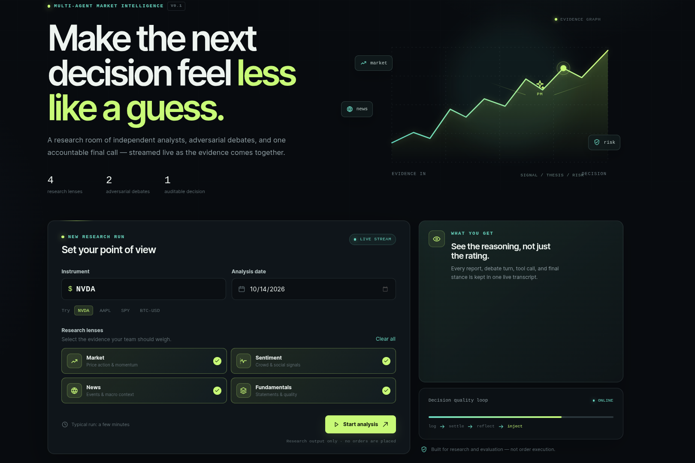
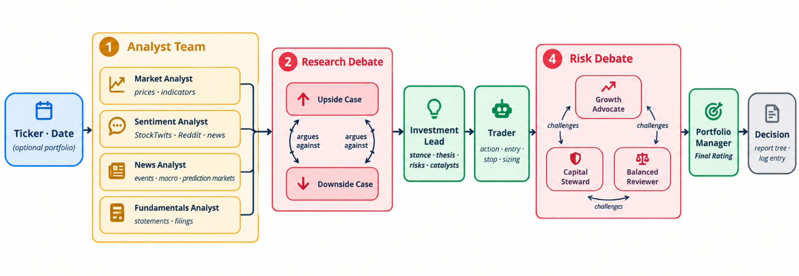
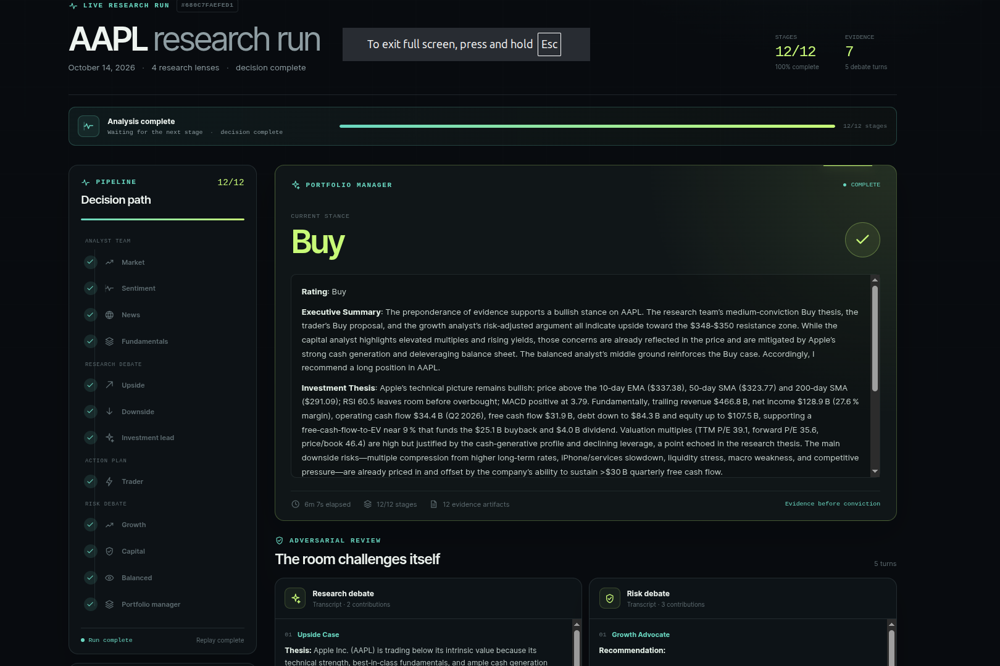

<div align="center">

# tradeagents

**Multi-agent market research for decisions you can actually inspect.**

Four independent analysts gather evidence. Two adversarial debates challenge it. A trader turns the thesis into an action plan. Three risk reviewers pressure-test the plan before a portfolio manager makes the final call.

[Quick start](#quick-start) · [How it works](#how-it-works) · [Web workspace](#web-workspace) · [Providers](#supported-llm-providers) · [Data and memory](#data-and-memory) · [Backtesting](#backtesting) · [Development](#development)

</div>

<p align="center">
  
</p>

> **Research tool, not an execution system.** `tradeagents` produces a rating, thesis, supporting evidence, and an auditable report trail. It does not route orders, simulate fills, or maintain a live position ledger.

## Why tradeagents?

Market analysis is often presented as a single confident paragraph. `tradeagents` keeps the reasoning visible instead: independent specialists work from point-in-time data, opposing cases are written into a transcript, and the final stance is structured rather than inferred from prose.

A run gives you:

- **Independent evidence** — market, sentiment, news, and fundamentals lenses can be selected independently.
- **Adversarial reasoning** — upside and downside researchers debate the evidence before a plan is drafted.
- **Risk-aware action** — a trader proposes action, entry, stop, and sizing; growth, capital, and balanced reviewers challenge it.
- **A durable artifact** — reports, debate turns, tool calls, decisions, settlements, and reflections are written to disk.
- **Live visibility** — the terminal and web workspace show progress while the graph is running, not only after it finishes.

## How it works

<p align="center">
  
</p>

The pipeline is assembled from registries and shared debate machinery rather than one-off orchestration code:

1. **Analyst team** — selected analysts collect data through the vendor router and write reports.
2. **Research debate** — an upside case and a downside case challenge those reports; the Investment Lead synthesizes the result.
3. **Trader** — the thesis becomes a concrete investment plan.
4. **Risk debate** — Growth Advocate, Capital Steward, and Balanced Reviewer test the plan from different risk perspectives.
5. **Portfolio Manager** — emits a typed rating and a readable final decision.
6. **Memory loop** — decisions are logged, settled after their holding window, reflected on, and injected into future runs for the same ticker.

The debate transcript is the state. Round numbers are derived from the ordered turns, so the same generic machinery can support a two-sided research debate, a three-sided risk debate, or another participant list later.

## Quick start

### Prerequisites

- Python 3.11 or newer
- An API key for one supported LLM provider; OpenAI is the default
- Node.js 20+ and npm for the web workspace
- Optional data keys: `FRED_API_KEY`, `ALPHA_VANTAGE_API_KEY`, `TYPESAFE_API_KEY`

### Install

```bash
git clone https://github.com/a-janjan/tradeagents.git
cd tradeagents

# uv (recommended)
uv venv --python 3.12
source .venv/bin/activate
uv pip install -e ".[dev,api]"

# or plain pip
python -m venv .venv
source .venv/bin/activate
pip install -e ".[dev,api]"
```

Install the frontend dependencies once:

```bash
cd frontend
npm install
cd ..
```

### Configure

```bash
cp .env.example .env
```

Set at least one model provider key, for example:

```bash
OPENAI_API_KEY=sk-...
```

The rest of the configuration lives in `tradeagents/default_config.py` and can be overridden by environment variables or a caller-provided config dictionary.

### Run from the CLI

```bash
# one analysis with live terminal progress
python -m tradeagents NVDA 2026-10-01

# save the report tree to results/reports/
python -m tradeagents NVDA 2026-10-01 --save

# focus the run on two lenses
python -m tradeagents NVDA 2026-10-01 --analysts=market,news
```

### Run the API and web workspace

Terminal one:

```bash
uvicorn tradeagents.api.main:app --reload --port 8000
```

Terminal two:

```bash
cd frontend
npm run dev
```

Open <http://localhost:5173>. The web client submits a run, follows its replayable SSE stream, and shows the pipeline, live node output, debates, reports, and final decision in one workspace.

## Web workspace

The frontend is intentionally a focused research room rather than a generic admin panel. It includes:

- a run composer with local-date-safe date handling, ticker suggestions, and analyst lens cards;
- a live pipeline with completed/current/future states;
- an SSE output tail that reconnects without duplicating the transcript;
- expandable research reports and debate transcripts;
- recent run history with graceful empty/offline states;
- responsive layouts for laptop, tablet, and mobile widths;
- local CSS and inline SVG icons, so the preview does not depend on a CDN or remote font.

<p align="center">
  
</p>

The API proxy is server-side. Browser code calls relative `/api/...` URLs; Vite forwards them to `http://localhost:8000` during development. This keeps the hosted preview from trying to reach the browser's own `localhost`.

See [`frontend/README.md`](frontend/README.md) for the component map and frontend-specific commands.

## Supported LLM providers

Provider selection is configured with `llm_provider` and the matching environment key.

| Provider | Environment key | Notes |
|---|---|---|
| OpenAI | `OPENAI_API_KEY` | Default provider. |
| Anthropic | `ANTHROPIC_API_KEY` | Claude models. |
| Google | `GOOGLE_API_KEY` | Gemini models. |
| xAI | `XAI_API_KEY` | Grok models. |
| DeepSeek | `DEEPSEEK_API_KEY` | Thinking models supported. |
| Qwen | `DASHSCOPE_API_KEY` | International endpoint. |
| GLM | `ZHIPU_API_KEY` | Z.AI / international. |
| MiniMax | `MINIMAX_API_KEY` | M2.x reasoning models. |
| Kimi | `MOONSHOT_API_KEY` | Moonshot models. |
| Mistral | `MISTRAL_API_KEY` | |
| Groq | `GROQ_API_KEY` | |
| NVIDIA | `NVIDIA_API_KEY` | NIM. |
| OpenRouter | `OPENROUTER_API_KEY` | |
| Azure OpenAI | Azure settings | Set the Azure endpoint and deployment. |
| AWS Bedrock | AWS credential chain | Install the optional Bedrock extra. |
| Ollama | — | Local; set `OLLAMA_BASE_URL` if remote. |
| OpenAI-compatible | — | vLLM, LM Studio, llama.cpp, or a relay. |

For provider-specific settings, see `.env.example` and the defaults in `tradeagents/default_config.py`.

## CLI usage

```text
python -m tradeagents TICKER YYYY-MM-DD [options]
```

Useful options include:

| Option | Purpose |
|---|---|
| `--save[=PATH]` | Write the report tree to a timestamped directory or the supplied path. |
| `--analysts=market,news` | Select a subset of analyst registries. |
| `--no-display` | Disable the terminal live progress display. |
| `--debug` | Use the verbose debug path. |

The exact CLI surface is available with:

```bash
python -m tradeagents --help
```

## Python API

The graph can be used directly when a caller needs a custom integration:

```python
from tradeagents.graph.trading_graph import TradingGraph

config = {
    "llm_provider": "openai",
    "quick_think_llm": "gpt-4.1-mini",
    "deep_think_llm": "gpt-4.1",
    "results_dir": "results",
}

graph = TradingGraph(
    selected_analysts=("market", "news", "fundamentals"),
    config=config,
)
result, _ = graph.propagate("NVDA", "2026-10-01", asset_type="stock")
print(result["final_rating"])
```

For a portfolio-aware run, validate a `PortfolioContext` and pass it to the graph. The CLI and API share the same decision log and report conventions.

## API surface

The FastAPI app exposes the live workspace contract:

| Endpoint | Purpose |
|---|---|
| `GET /api/health` | Health check. |
| `POST /api/runs` | Start a background graph run. |
| `GET /api/runs` | List in-process run summaries. |
| `GET /api/runs/:id` | Read one run summary and final state. |
| `GET /api/runs/:id/stream` | Replay history, then stream live normalized events over SSE. |
| `GET /api/runs/:id/events` | Return the complete event log as JSON. |
| `GET /api/decisions` | Read decision-log entries, optionally filtered by ticker. |
| `POST /api/decisions/settle` | Run a settlement pass. |
| `POST /api/backtests` | Start a backtest grid. |
| `GET /api/backtests/:id` | Read a backtest result. |

Event payloads are flat dictionaries with a `type` and `ts`: `run.started`, `token`, `tool.started`, `tool.finished`, `node.finished`, `report`, `debate.turn`, `decision`, `run.state`, `run.finished`, and `run.failed`. A reconnecting client receives history again; the frontend de-duplicates replayed payloads.

## Data and memory

The vendor router is explicit and behavior-oriented. Vendors raise shared error types, and the router chooses fallbacks based on behavior rather than vendor-specific exception branches.

Included data integrations cover:

- Yahoo Finance prices, OHLCV, indicators, fundamentals, and news;
- Alpha Vantage as an alternate price/fundamental/news source;
- SEC EDGAR filings;
- FRED macro series with point-in-time vintage handling;
- Polymarket event probabilities;
- Reddit and StockTwits social context.

The pipeline applies date windows so an analysis cannot fetch prices beyond its analysis date. The decision log is JSONL and acts as the source of truth for settlement, reflection, backtest scoring, and future context.

### The memory loop

```text
run decision → holding window → realized return + alpha
      ↑                                  ↓
  future context ← reflection ← settlement
```

Missing context stays missing; it is not silently converted into an empty report. That distinction keeps prompts from treating unavailable evidence as evidence of nothing.

## Backtesting

The backtest runner sweeps tickers and dates, skips existing cells where possible, records decisions in the same log, settles resolved entries, and summarizes outcomes by rating. It evaluates decision quality; it is not a fill-level trading simulator.

CLI example:

```bash
python -m tradeagents.backtest \
  --tickers NVDA,AAPL \
  --start 2025-01-01 \
  --end 2026-01-01 \
  --every-n-days 14
```

The API exposes the same grid runner for integrations that need a background job.

## Observability

Optional Langfuse integration can trace graph nodes, LLM calls, and tool calls. The terminal progress display consumes the same normalized stream used by the API, so a slow tool or a streaming model response is visible rather than looking like a frozen process.

## Configuration

Start from `.env.example`. Common keys include:

```bash
OPENAI_API_KEY=...
LLM_PROVIDER=openai
QUICK_THINK_LLM=gpt-4.1-mini
DEEP_THINK_LLM=gpt-4.1
RESULTS_DIR=results
MEMORY_LOG_PATH=results/decisions.jsonl
DATA_CACHE_DIR=results/cache
```

Configuration is resolved from defaults, environment variables, and explicit dictionaries. See `tradeagents/dataflows/config.py` and `tradeagents/default_config.py` for the complete set.

## Extending the system

### Add an analyst

Add the node and prompt, then register it in the analyst registry. The graph builder walks the registry, so the orchestration path does not need a new hard-coded branch.

### Add a data vendor

Add a vendor module under `tradeagents/dataflows/vendors/`, raise the shared error taxonomy, and add a router row. Fallback behavior stays centralized.

### Add an LLM provider

OpenAI-compatible providers can be a registry row. Genuinely different APIs can implement the provider client interface and be added to the factory.

## Reproducibility and point-in-time behavior

The same ticker and date will not produce identical text: model sampling and live social/news feeds vary. The deterministic boundaries are more important:

- price and indicator windows stop at the analysis date;
- fundamentals are used as filed where the vendor supports filing dates;
- macro data is pinned to the vintage known by the analysis date;
- instrument identity is resolved before agent work begins;
- the final rating is read from typed output rather than guessed from prose.

Use a lower temperature and a non-reasoning model when a tighter experiment is useful, but do not assume provider outputs are byte-identical.

## Project layout

```text
tradeagents/
├── agents/                  # analysts, researchers, risk, trader, schemas
├── api/                     # FastAPI routes, SSE events, run manager
├── backtest/                # grid runner and scoring
├── dataflows/               # vendors, router, symbols, date windows
├── graph/                   # registries, orchestration, progress adapters
├── llm_clients/             # provider factory
├── memory/                  # log, settlement, reflection, context
├── portfolio.py             # caller portfolio context
├── reporting.py             # report tree writer
└── default_config.py        # defaults and environment overrides
frontend/
├── src/components/          # run form, pipeline, reports, decision UI
├── src/hooks/               # SSE subscription
└── src/pages/RunPage.tsx    # live research room
docs/
├── architecture.svg         # local README architecture illustration
├── live-run.svg             # local README live-run illustration
└── ui-overview.svg          # local README workspace illustration
results/                     # example/API artifacts and saved reports
tests/                       # unit and integration-oriented tests
```

## Development

```bash
# install project and development/API extras
uv pip install -e ".[dev,api]"

# fast unit suite
pytest -m unit

# Python lint and formatting
ruff check .
ruff format .

# frontend
cd frontend
npm install
npm run build
npm run lint
```

Run the API tests separately when needed:

```bash
pytest tests/test_api.py
```

The included Vite config binds development and preview servers to `0.0.0.0`, allows the hosted preview origin, and proxies `/api` without exposing a browser-side localhost dependency.

## Markets and symbols

Any instrument covered by the configured vendors can be used, including exchange-suffixed equities and crypto pairs:

| Market | Example |
|---|---|
| US | `AAPL`, `NVDA`, `SPY` |
| Hong Kong | `0700.HK` |
| Tokyo | `7203.T` |
| London | `AZN.L` |
| India | `RELIANCE.NS` |
| Canada | `SHOP.TO` |
| Australia | `BHP.AX` |
| China A-shares | `600519.SS`, `000001.SZ` |
| Crypto | `BTC-USD`, `ETH-USD` |

Common broker-style symbols are normalized to vendor conventions, for example `XAUUSD` → `GC=F`, `BTCUSD` → `BTC-USD`, and `SPX500` → `^GSPC`.

## What this is not

`tradeagents` is not:

- an execution system;
- an order manager or live position ledger;
- a fill-accurate portfolio simulator;
- investment advice;
- a guarantee of future results.

The most useful artifact is the transcript: read the evidence and debates before you read the rating.

## License

Apache 2.0. See `LICENSE`.

## Acknowledgments

Built with [LangGraph](https://github.com/langchain-ai/langgraph), [LangChain Core](https://github.com/langchain-ai/langchain), [yfinance](https://github.com/ranaroussi/yfinance), [stockstats](https://github.com/jealous/stockstats), [FastAPI](https://fastapi.tiangolo.com/), [React](https://react.dev/), and [Vite](https://vite.dev/).
