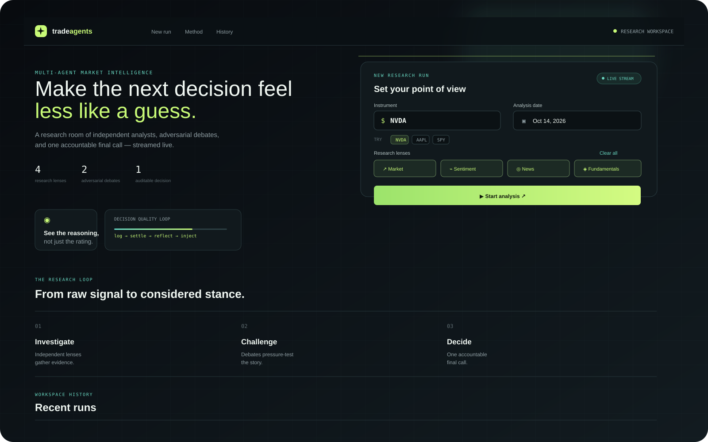
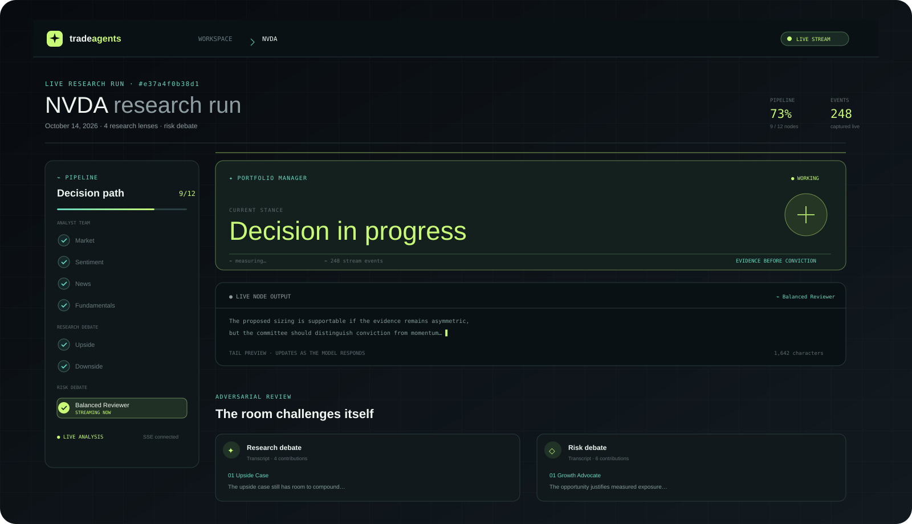

# tradeagents web workspace

The `frontend/` folder is the live research workspace for [tradeagents](../README.md). It is a Vite + React + TypeScript client that starts a run, follows the API's Server-Sent Events stream, and turns the pipeline into a readable research room.

## What is on screen

- **New research run** — choose a ticker, point-in-time date, and research lenses.
- **Live pipeline** — analysts, debates, trader, risk reviewers, and the portfolio manager light up as they finish.
- **Streaming output** — the active node's response is pinned to a rolling, Markdown-formatted preview.
- **Decision card** — the final rating, thesis, elapsed time, stage progress, and evidence count stay visible.
- **Evidence archive** — reports and debate transcripts remain expandable after the run completes.
- **Workspace history** — recent runs are fetched from `GET /api/runs` and link back to their SSE replay.





## Local development

From the repository root:

```bash
# terminal 1 — API
uvicorn tradeagents.api.main:app --reload --port 8000

# terminal 2 — frontend
cd frontend
npm install
npm run dev
```

Open <http://localhost:5173>. Vite proxies `/api` to `http://localhost:8000`, so browser code only uses relative API URLs.

## Useful commands

```bash
npm run dev       # Vite dev server with HMR
npm run build     # TypeScript project build + production bundle
npm run lint      # Oxlint
npm run preview   # Preview the production bundle
```

The dev and preview servers bind to `0.0.0.0` and allow the hosted preview origin. The API proxy remains server-side; the browser never needs to call `localhost` directly.

## Frontend shape

```text
src/
├── components/
│   ├── DecisionCard.tsx       # final stance and run status
│   ├── Icon.tsx               # dependency-free inline SVG icons
│   ├── PipelineGraph.tsx      # stage progress and active node
│   ├── RecentRuns.tsx         # history list
│   ├── ReportPanel.tsx        # expandable report archive
│   ├── RunForm.tsx            # new run controls
│   └── TokenPreview.tsx       # rolling streamed output
├── hooks/useRunStream.ts      # SSE subscription + reconnect de-duplication
├── pages/RunPage.tsx          # live run workspace
├── api.ts                     # typed REST calls
└── types.ts                   # API event contracts
```

## API contract

The frontend expects the FastAPI application to expose:

- `POST /api/runs` to create a run;
- `GET /api/runs` for recent run summaries;
- `GET /api/runs/:run_id/stream` for replayable SSE events.

The stream replays history when a browser reconnects. `useRunStream` de-duplicates replayed payloads so a temporary network hiccup does not duplicate the transcript.

## Styling notes

The interface intentionally uses local CSS, inline SVG icons, and no remote font or image dependencies. That keeps the in-app preview usable in a sandboxed iframe and makes the built UI render consistently offline.
